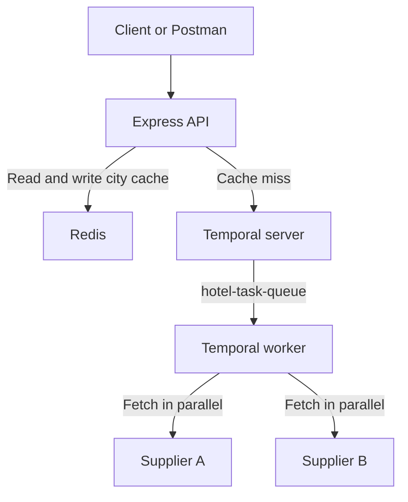

# Hotel Offer Orchestrator

A TypeScript backend that searches two hotel suppliers in parallel, keeps the cheapest offer for each hotel, and filters the results by price inside Redis. The API preserves the supplier and commission of the winning offer.

**Stack** · Node.js 22 · TypeScript · Express · Temporal · Redis · Docker Compose

## Quick start

You need a running Docker engine with Docker Compose v2. On Windows, start Docker Desktop. Open a terminal in the repository root and start the stack.

```powershell
docker compose up --build -d
docker compose ps
```

The API is available at [localhost:3000](http://localhost:3000) and the Temporal UI at [localhost:8233](http://localhost:8233). Wait for the worker's `RUNNING` log before making a search that needs to fetch supplier offers. The local stack uses mock suppliers and requires no API keys.

```powershell
curl.exe -i "http://localhost:3000/health"
curl.exe -i "http://localhost:3000/api/hotels?city=delhi&minPrice=5000&maxPrice=6000"
```

Use `curl` in place of `curl.exe` on macOS or Linux. Run `docker compose down` to stop the stack.

## API reference

| Method | Endpoint | Purpose |
| --- | --- | --- |
| GET | `/api/hotels?city=delhi` | Return the cheapest offer per hotel, sorted by ascending price. |
| GET | `/api/hotels?city=delhi&minPrice=5000&maxPrice=6000` | Return winning offers within the inclusive price range. |
| GET | `/supplierA/hotels?city=delhi` | Return Supplier A's raw hotel records. Omit `city` to see all of Supplier A's records. |
| GET | `/supplierB/hotels?city=delhi` | Return Supplier B's raw hotel records. Omit `city` to see all of Supplier B's records. |
| GET | `/health` | Check Redis and both mock suppliers. Return HTTP 503 if any check fails. |

### Hotel search

`city` is required. City matching is case-insensitive. `minPrice` and `maxPrice` are optional non-negative numbers in INR. Either bound can be supplied on its own.

The ₹5,000–₹6,000 Delhi search returns HTTP `200` and the following offers.

```json
[
  {
    "name": "Holtin",
    "price": 5340,
    "supplier": "Supplier B",
    "commissionPct": 20
  },
  {
    "name": "Radison",
    "price": 5900,
    "supplier": "Supplier A",
    "commissionPct": 13
  }
]
```

Successful searches include an `X-Cache` header. `HIT` means Redis had the city snapshot on the initial cache check. `MISS` means the request needed a refresh, which it can share with another request for the same city.

| Result | Status | Response |
| --- | --- | --- |
| Matching offers | `200` | Array of hotel offers |
| Unknown city or no offers in range | `200` | `[]` |
| Missing or repeated city, invalid prices, or inverted range | `400` | JSON object containing `error` |
| Workflow or Redis failure during a search | `503` | JSON object containing `error` |

### Health response

```json
{
  "status": "healthy",
  "redis": "PONG",
  "suppliers": {
    "supplierA": "up",
    "supplierB": "up"
  }
}
```

A successful search on a cache miss also verifies that the Temporal worker can execute the supplier workflow.

## How it works



The two mock supplier routes live in the Express API. On a cache miss, the API starts a Temporal workflow that schedules one HTTP activity per supplier. Each activity can make up to three attempts. The workflow normalizes hotel names, selects each cheapest offer, and gives Supplier A priority when two prices are equal.

Express stores the complete set of winning offers in Redis for **300 seconds** by default. Concurrent misses for the same city share a refresh within one API process. Searches for different price ranges reuse the same city snapshot.

| Redis key example | Type | Use |
| --- | --- | --- |
| `hotels:delhi` | Sorted set | Index normalized hotel names by price. |
| `hotels:delhi:data` | Hash | Store each winning offer as JSON. |
| `hotels:delhi:ready` | String | Mark a populated snapshot, including a cached empty result. |

Redis selects names by score first, and the API reads only the corresponding offer details. For example, searching ₹6,000–₹6,200 returns an empty array because each hotel's winning quote falls outside that range.

After a Delhi search, inspect the Redis price index during the cache lifetime.

```powershell
docker compose exec -T redis redis-cli ZCARD hotels:delhi
docker compose exec -T redis redis-cli ZRANGE hotels:delhi 5000 6000 BYSCORE WITHSCORES
```

The index should contain four hotels. The range query should show `holtin` with score `5340` and `radison` with score `5900`.

## Tests and Postman

Keep the Compose stack running and use Node.js 22 on the host to run the tests.

```powershell
npm ci
npm run typecheck
node --import tsx --test test/deduplication.test.ts
node --test test/api.test.cjs
```

The suite includes **4 unit tests** for offer selection and **7 API tests** for health, supplier data, response format, price boundaries, validation, and cache behavior. The cache test uses a fresh city value to verify `MISS` followed by `HIT` without clearing existing data. Set `TEST_BASE_URL` to target a different API URL.

Import the [Postman collection](postman/Hotel-Offer-Orchestrator.postman_collection.json) and run it locally against `http://localhost:3000`. The collection contains **7 requests and 14 assertions**. The invalid-range request passes when it receives the expected HTTP `400`.

## Run the API and worker on the host

For development outside the API and worker containers, run Redis and a Temporal development server locally. Use these values in a local `.env` for the default ports.

```dotenv
PORT=3000
REDIS_URL=redis://127.0.0.1:6379
TEMPORAL_ADDRESS=127.0.0.1:7233
SUPPLIER_BASE_URL=http://127.0.0.1:3000
CACHE_TTL_SECONDS=300
```

Run `npm ci`, then start the API with `npm run dev` and the worker with `npm run worker` in separate terminals. The host API needs port 3000 free. Keep `.env` local.

## Project layout

| Path | Responsibility |
| --- | --- |
| `src/routes/` | Express search and mock supplier endpoints |
| `src/services/` | Deduplication, Redis connection, and cache operations |
| `src/temporal/` | Workflow, supplier activities, worker, and client |
| `src/types/` | Supplier record and public offer types |
| `test/` | Unit and HTTP integration tests |
| `postman/` | Importable API collection |
| `Dockerfile` and Compose configuration | Build and run the local stack |

The Compose stack uses Temporal's development server. For startup issues, check `docker compose logs --tail=50 api worker temporal redis`. For a failed search, open its workflow in the Temporal UI and inspect the supplier activity results.

## Author

Nishant Pal